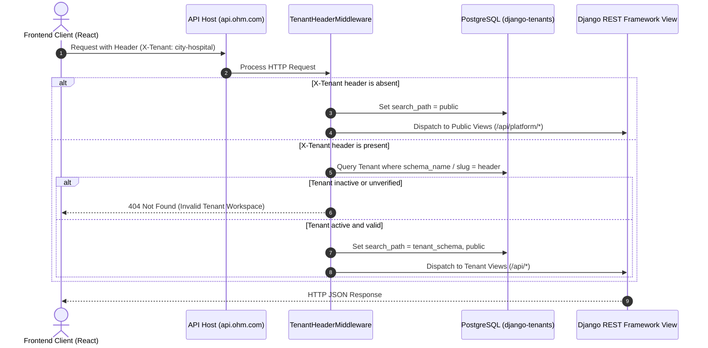
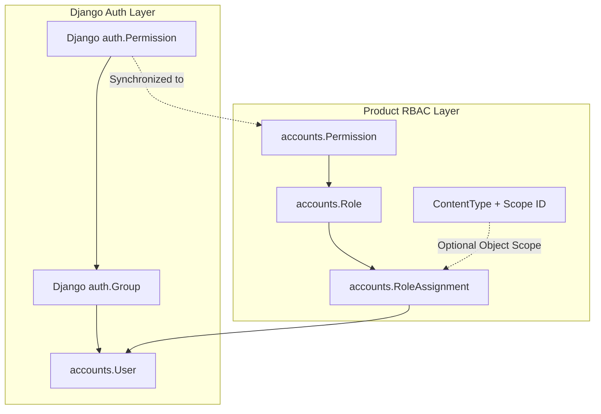
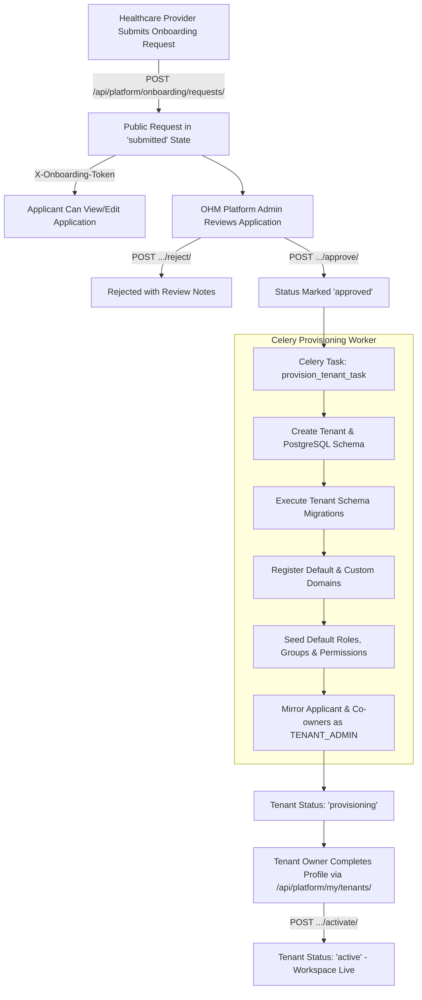

# OHM Multi-Tenant Architecture & Technical Design

OHM is a multi-tenant aggregator platform for healthcare service providers (hospitals, clinics, multi-specialty centers). Each healthcare provider operates in an isolated PostgreSQL database schema managed through **django-tenants**, while the platform control plane resides in the `public` schema.

---

## 1. Core Architectural Principles

1. **Strict Data Isolation (Healthcare Compliance)**: Operational healthcare records, patient identities, appointments, and financial records never mix across providers. Every provider workspace is allocated its own database schema.
2. **Unified API Gateway**: React frontends communicate with a single API hostname (`api.ohm.com`). Schema switching is determined dynamically via the `X-Tenant` header or direct verified domain lookup.
3. **Single Identity, Contextual Access**: The `accounts.User` model exists across schemas. A user's JWT token contains an explicit `schema` claim, binding authorization tokens strictly to the schema in which they were issued.
4. **Dual-Layer RBAC Engine**: Combines Django's standard `auth.Permission` and `auth.Group` with product-level `accounts.Role`, `accounts.Permission`, and object-scoped `accounts.RoleAssignment`.
5. **Non-blocking Asynchronous Operations**: Heavy workloads (schema migrations, tenant provisioning, custom domain DNS verification) are offloaded to **Celery** workers backed by **Redis**.

---

## 2. Ownership Boundary & Data Partitioning

```
                     ┌──────────────────────────────────────────────┐
                     │            PostgreSQL Database               │
                     └──────────────────────┬───────────────────────┘
                                            │
                    ┌───────────────────────┴───────────────────────┐
                    ▼                                               ▼
         ┌─────────────────────┐                         ┌─────────────────────┐
         │    Public Schema    │                         │   Tenant Schemas    │
         │   (Control Plane)   │                         │(Provider Workspaces)│
         └──────────┬──────────┘                         └──────────┬──────────┘
                    │                                               │
   • Platform Admins & Staff Users                 • Provider Admins & Employees
   • Tenant Metadata (name, slug, status)          • Customer / Patient Accounts
   • Custom Domains & Verification Tokens          • Workspace Roles & Assignments
   • Subscriptions, Plans & Features               • Operational Records (Bookings,
   • Onboarding Requests & Approvals                 Analysis, Payroll, Wallets)
```

### Detailed Boundary Mapping

| Entity Area | Managing Persona | Database Schema | Model References |
| :--- | :--- | :--- | :--- |
| **Platform Infrastructure** | OHM Super Admins | `public` | `platform.Tenant`, `platform.Domain` |
| **Subscriptions & Plans** | OHM Super Admins | `public` | `platform.Plan`, `platform.Subscription`, `platform.Feature` |
| **Platform Staff & Profiles**| OHM Super Admins | `public` | `accounts.User` (`is_staff`/`is_superuser`), `platform.PlatformAdmin` |
| **Provider Onboarding** | Platform Admin & Applicant | `public` | `platform.TenantProvisioning` |
| **Workspace Identity & Staff** | Tenant Admin | Tenant Schema | `accounts.User`, `accounts.EmployeeProfile` |
| **Workspace RBAC & Permissions** | Tenant Admin | Tenant Schema | `accounts.Role`, `accounts.Permission`, `accounts.RoleAssignment` |
| **Operational Records** | Healthcare Provider | Tenant Schema | Future modules: `booking`, `analysis`, `payroll`, `venue_manager`, `wallet`, `faq` |

> [!IMPORTANT]
> The `public` schema's `Tenant` record is infrastructure for the OHM control plane. It is strictly excluded from provider tenant CRUD operations and must never be deleted, suspended, or used as a healthcare provider workspace.

---

## 3. Dynamic Request Routing & Schema Switching

### Ingress Lifecycle Flow



### Routing Rules
- **Public Traffic**: Requests without `X-Tenant` stay in the `public` schema. This is used for platform administration, public plan catalog inspection, onboarding request submissions, and platform staff login.
- **Tenant Workspace Traffic**: Requests with `X-Tenant: <tenant-slug>` resolve the tenant in the database, verify that the workspace is active, and switch the PostgreSQL connection's search path to that tenant's schema before URL resolution.
- **Direct Domain Traffic**: When a request arrives at a verified custom domain (e.g., `app.cityhospital.com`), `VerifiedDomainTenantMiddleware` extracts the host, matches it against verified `Domain` rows, and automatically routes to the appropriate schema.

---

## 4. Authentication & Token Architecture

OHM implements a unified authentication engine via `UnifiedLoginView`:

```
                POST /api/auth/login/
            ┌─────────────┴─────────────┐
     Password Login                  OTP Login
            │                             │
    Verify Hash (Argon2/PBKDF2)     Verify OTP against Redis (5-min TTL)
            └─────────────┬─────────────┘
                          ▼
            Check user.is_active Status
                          ▼
          Generate SimpleJWT Refresh & Access Tokens
               refresh["schema"] = current_schema
                          ▼
        Return User Profile, Tokens & Schema Name
```

### Security Guarantees
1. **Schema Binding**: The issuing schema's name is embedded directly into the JWT payload (`refresh["schema"] = connection.schema_name`).
2. **Boundary Enforcement**: In `TenantJWTAuthentication`, every authenticated request checks:
   ```python
   token_schema = token.get("schema")
   if token_schema != connection.schema_name:
       raise AuthenticationFailed("Token is not valid for this tenant workspace.")
   ```
   A token obtained from the public schema or a different tenant is rejected immediately.
3. **Session Revocation**: Login creates a schema-local `UserSession`; access tokens are checked against its active state, and refresh tokens must match the latest session JTI. Logout revokes the current session. Password reset revokes all sessions.
4. **OTP Security**: One-Time Passwords are 6-digit numeric codes cached in Redis with a 5-minute time-to-live (TTL). They are bound to specific purposes (`login` or `password_reset`), rate-limited by client IP and account identifier, and deleted upon first verification (single-use). OTP values are never written to application logs.
5. **Short-Lived Access**: Access tokens expire after 15 minutes. Refresh tokens rotate and the prior JTI is rejected by the session record.

---

## 5. Dual-Layer RBAC & Permission Architecture

The authorization layer bridges Django standard permissions and tenant product permissions:



### 1. Group Rules & Default Permissions Matrix
When a schema is created or synced, `seed_roles_and_groups_for_schema` automatically builds `auth.Group` and `accounts.Role` instances based on `GROUP_RULES`:

```python
GROUP_RULES = {
    # Public Platform Super Admin: unrestricted access
    Role.Code.SUPER_ADMIN: "__all__",

    # Tenant Admin: unrestricted access across all tenant product modules
    Role.Code.TENANT_ADMIN: {
        "apps": ["accounts", "venue_manager", "booking", "payroll", "notification", "analysis", "wallet", "faq"],
        "actions": "__all__",
    },

    # Ops Manager: view, change, add across all operational modules
    Role.Code.OPS_MANAGER: {
        "apps": ["accounts", "venue_manager", "booking", "payroll", "notification", "analysis", "wallet", "faq"],
        "actions": ["view", "change", "add"],
    },

    # Specific Admins & Staff: scoped module actions
    Role.Code.VENUE_ADMIN:    {"apps": ["venue_manager", "booking", "payroll", "notification"], "actions": ["view", "change", "add"]},
    Role.Code.SERVICE_ADMIN:  {"apps": ["venue_manager", "booking", "payroll", "notification"], "actions": ["view", "change", "add"]},
    Role.Code.RESOURCE_ADMIN: {"apps": ["venue_manager", "booking", "payroll", "notification"], "actions": ["view", "change", "add"]},
    Role.Code.STAFF:          {"apps": ["venue_manager", "booking", "payroll", "notification"], "actions": ["view"]},

    # Customer: view & add on end-user features
    Role.Code.CUSTOMER:       {"apps": ["booking", "wallet", "accounts"], "actions": ["view", "add"]},
}
```

### 2. Tenant-Wide vs. Object-Scoped Permissions
- **Tenant-Wide**: `RoleAssignment.scope_type = None` and `scope_id = None`. The user holds the role across the entire workspace.
- **Object-Scoped**: `RoleAssignment` connects to a specific Django `ContentType` and model instance ID (e.g. `booking.Venue` ID 4). This allows fine-grained permissions such as assigning a user as `VENUE_ADMIN` for a specific physical branch.

### 3. Protection Invariants
- Built-in roles (`TENANT_ADMIN`, `CUSTOMER`) cannot have their codes or ranks modified, and cannot be deleted.
- Custom roles cannot be assigned ranks $\ge 100$ (reserved for administrators).
- A workspace cannot deactivate or revoke its last active `TENANT_ADMIN`.
- Deleting a role that has active assignments returns HTTP 409 Conflict.

---

## 6. Onboarding & Asynchronous Provisioning Pipeline



---

## 7. Custom Domain Verification & SSL Management

```
                                 DNS Settings
                         ┌──────────────────────────┐
                         │ CNAME -> edge.ohm.com    │
                         │ TXT   -> _ohm-verify=... │
                         └────────────┬─────────────┘
                                      │
                                      ▼
                        Celery Beat Scheduled Task
                        verify_pending_domains (5m)
                                      │
                         ┌────────────┴────────────┐
                         ▼                         ▼
                  TXT / CNAME Valid        Verification Failed
                         │                         │
                         ▼                         ▼
                Domain.verified = True       Remains Pending
                         │
                         ▼
             Caddy SSL Reverse Proxy
           Calls /internal/domain-check/
        Issues Let's Encrypt Certificate
```

1. **DNS Verification**: Celery beat queries public DNS for the expected TXT token prefix and CNAME pointer.
2. **Certificate Issuance**: When HTTPS requests hit Caddy, Caddy initiates an internal HTTP check to `/internal/domain-check/?domain=<host>`. The backend validates the domain's existence and verification status before Caddy issues the TLS certificate on-demand.

---

## 8. Extending OHM with Future Product Modules

When building new operational features (e.g., `booking`, `payroll`, `analysis`):

1. **Schema Strategy**: All operational healthcare apps belong to `TENANT_APPS` in `config/settings.py`. They run within the tenant schema and use tenant-scoped database tables.
2. **Cross-Tenant Safety**: Never query across schemas directly. Celery tasks that operate on tenant data must subclass `TenantTask` and receive `schema_name` in keyword arguments:
   ```python
   from django_tenants.tasks import TenantTask

   @shared_task(base=TenantTask)
   def generate_payroll_report(schema_name, pay_period_id):
       # Automatically executes inside the specified tenant schema context
       ...
   ```
3. **Module Feature Flags**: Tenants have an `enabled_modules` list (`Tenant.modules`). Platform admins grant access via `PATCH /api/platform/tenants/{id}/permissions/`. Custom views can guard access using DRF permissions.
