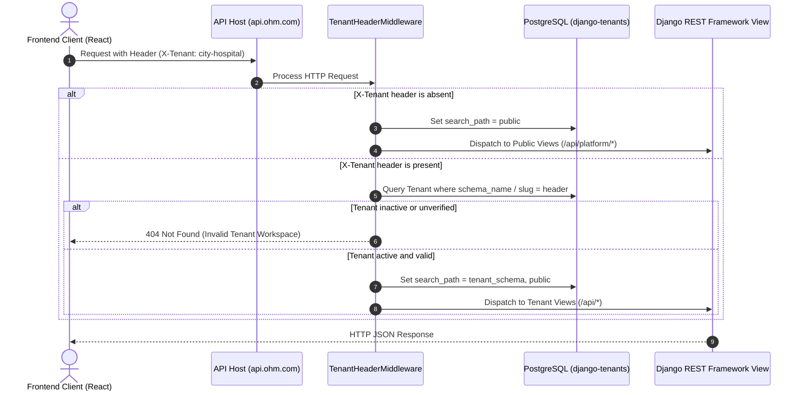
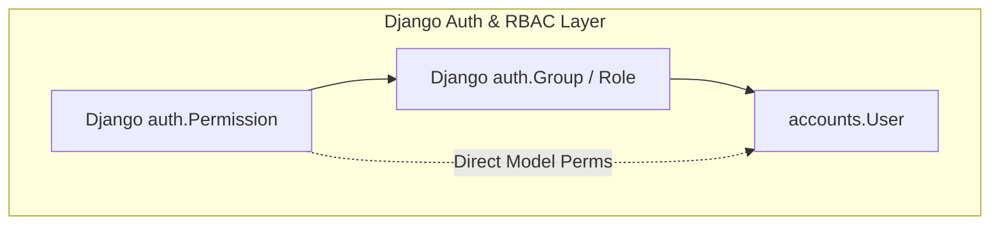
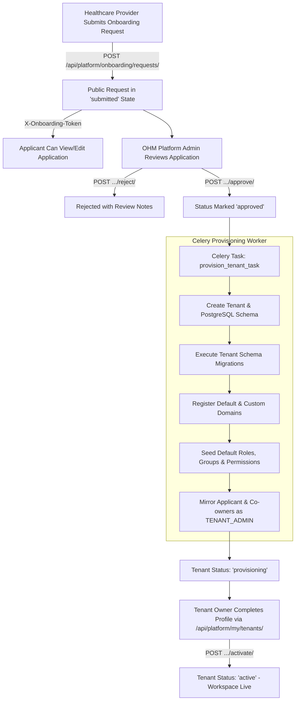

# OHM Multi-Tenant Architecture & Technical Design

OHM is a multi-tenant aggregator platform for healthcare service providers (hospitals, clinics, multi-specialty centers). Each healthcare provider operates in an isolated PostgreSQL database schema managed through **django-tenants**, while the platform control plane resides in the `public` schema.

---

## 1. Core Architectural Principles

1. **Strict Data Isolation (Healthcare Compliance)**: Operational healthcare records, patient identities, appointments, and financial records never mix across providers. Every provider workspace is allocated its own database schema.
2. **Unified API Gateway**: React frontends communicate with a single API hostname (`api.ohm.com`). Schema switching is determined dynamically via the `X-Tenant` header or direct verified domain lookup.
3. **Single Identity, Contextual Access**: The `accounts.User` model exists across schemas. A user's JWT token contains an explicit `schema` claim, binding authorization tokens strictly to the schema in which they were issued.
4. **Django-Native RBAC Engine**: Utilizes Django's standard `auth.Permission` and `auth.Group` models as roles, mirroring the Django Admin permission structure and eliminating separate role/role assignment entities.
5. **Non-blocking Asynchronous Operations**: Heavy workloads (schema migrations, tenant provisioning, custom domain DNS verification) are offloaded to **Celery** workers backed by **Redis**.

---

## 2. Ownership Boundary & Data Partitioning

```
                     ┌──────────────────────────────────────────────┐
                     │            PostgreSQL Database               │
                     └──────────────────────┬───────────────────────┘
                                            │
                    ┌───────────────────────┴───────────────────────┐
                    ▼                                               ▼
         ┌─────────────────────┐                         ┌─────────────────────┐
         │    Public Schema    │                         │   Tenant Schemas    │
         │   (Control Plane)   │                         │(Provider Workspaces)│
         └──────────┬──────────┘                         └──────────┬──────────┘
                    │                                               │
   • Platform Admins & Staff Users                 • Provider Admins & Employees
   • Tenant Metadata (name, slug, status)          • Customer / Patient Accounts
   • Custom Domains & Verification Tokens          • Workspace Roles & Assignments
   • Subscriptions, Plans & Features               • Operational Records (Bookings,
   • Onboarding Requests & Approvals                 Analysis, Payroll, Wallets)
```

### Detailed Boundary Mapping

| Entity Area | Managing Persona | Database Schema | Model References |
| :--- | :--- | :--- | :--- |
| **Platform Infrastructure** | OHM Super Admins | `public` | `platform.Tenant`, `platform.Domain` |
| **Subscriptions & Plans** | OHM Super Admins | `public` | `platform.Plan`, `platform.Subscription`, `platform.Feature` |
| **Platform Staff & Profiles**| OHM Super Admins | `public` | `accounts.User` (`is_staff`/`is_superuser`), `platform.PlatformAdmin` |
| **Provider Onboarding** | Platform Admin & Applicant | `public` | `platform.TenantProvisioning` |
| **Workspace Identity & Staff** | Tenant Admin | Tenant Schema | `accounts.User`, `accounts.EmployeeProfile` |
| **Workspace RBAC & Permissions** | Tenant Admin | Tenant Schema | `auth.Group`, `auth.Permission` |
| **Operational Records** | Healthcare Provider | Tenant Schema | Future modules: `booking`, `analysis`, `payroll`, `venue_manager`, `wallet`, `faq` |

> [!IMPORTANT]
> The `public` schema's `Tenant` record is infrastructure for the OHM control plane. It is strictly excluded from provider tenant CRUD operations and must never be deleted, suspended, or used as a healthcare provider workspace.

---

## 3. Dynamic Request Routing & Schema Switching

### Ingress Lifecycle Flow



### Routing Rules
- **Public Traffic**: Requests without `X-Tenant` stay in the `public` schema. This is used for platform administration, public plan catalog inspection, onboarding request submissions, and platform staff login.
- **Tenant Workspace Traffic**: Requests with `X-Tenant: <tenant-slug>` resolve the tenant in the database, verify that the workspace is active, and switch the PostgreSQL connection's search path to that tenant's schema before URL resolution.
- **Direct Domain Traffic**: When a request arrives at a verified custom domain (e.g., `app.cityhospital.com`), `VerifiedDomainTenantMiddleware` extracts the host, matches it against verified `Domain` rows, and automatically routes to the appropriate schema.

---

## 4. Authentication & Token Architecture

OHM implements a unified authentication engine via `UnifiedLoginView`:

```
                POST /api/auth/login/
            ┌─────────────┴─────────────┐
     Password Login                  OTP Login
            │                             │
    Verify Hash (Argon2/PBKDF2)     Verify OTP against Redis (5-min TTL)
            └─────────────┬─────────────┘
                          ▼
            Check user.is_active Status
                          ▼
          Generate SimpleJWT Refresh & Access Tokens
               refresh["schema"] = current_schema
                          ▼
        Return User Profile, Tokens & Schema Name
```

### Security Guarantees
1. **Schema Binding**: The issuing schema's name is embedded directly into the JWT payload (`refresh["schema"] = connection.schema_name`).
2. **Boundary Enforcement**: In `TenantJWTAuthentication`, every authenticated request checks:
   ```python
   token_schema = token.get("schema")
   if token_schema != connection.schema_name:
       raise AuthenticationFailed("Token is not valid for this tenant workspace.")
   ```
   A token obtained from the public schema or a different tenant is rejected immediately.
3. **Session Revocation**: Login creates a schema-local `UserSession`; access tokens are checked against its active state, and refresh tokens must match the latest session JTI. Logout revokes the current session. Password reset revokes all sessions.
4. **OTP Security**: One-Time Passwords are 6-digit numeric codes cached in Redis with a 5-minute time-to-live (TTL). They are bound to specific purposes (`login` or `password_reset`), rate-limited by client IP and account identifier, and deleted upon first verification (single-use). OTP values are never written to application logs.
5. **Short-Lived Access**: Access tokens expire after 15 minutes. Refresh tokens rotate and the prior JTI is rejected by the session record.

---

## 5. Dual-Layer RBAC & Permission Architecture

The authorization layer bridges Django standard permissions and tenant product permissions:



### 1. Group Rules & Default Permissions Matrix
When a schema is created or synced, `seed_roles` automatically builds `auth.Group` instances with assigned `auth.Permission` sets based on `ROLE_SPECS`:

```python
ROLE_SPECS = [
    # Public Platform Super Admin: unrestricted access (public schema only)
    {"code": "SUPER_ADMIN", "group": "Super User", "scopes": {"public": [{}]}},

    # Tenant Admin: unrestricted access across all tenant product modules
    {"code": "TENANT_ADMIN", "group": "Tenant Admin", "scopes": {
        "public": [{"apps": ["platform"], "prefixes": ["view_"]}, {"apps": ["accounts"], "models": ["user"], "prefixes": ["view_", "change_"]}],
        "tenant": [{"exclude_apps": SYSTEM_APPS + ["platform"]}],
    }},

    # Specific built-in role groups:
    {"code": "CUSTOMER", "group": "CUSTOMER", "scopes": {"tenant": []}},
    {"code": "VENUE_ADMIN", "group": "VENUE_ADMIN", "scopes": {"tenant": []}},
    {"code": "SERVICE_ADMIN", "group": "SERVICE_ADMIN", "scopes": {"tenant": []}},
    {"code": "RESOURCE_ADMIN", "group": "RESOURCE_ADMIN", "scopes": {"tenant": []}},
]
```

### 2. Permissions Structure & Group Management
- **Direct Django Groups as Roles**: Permission groups (`auth.Group`) act as roles. Tenants create and manage them directly via `/api/groups/` with permissions assigned in a single step.
- **Group Members**: Users are added or removed from groups via `/api/groups/{id}/users/`.
- **Hierarchical Permission Tree**: `/api/permissions/grouped/` provides all Django permissions grouped by application and model, matching the Django Admin interface.
- **User Permission Assignment**: Users support `groups` and direct `user_permissions` (with serialized `group_details` and `user_permission_details`), mirroring Django Admin.

### 3. Protection Invariants
- Built-in permission groups (`Super User`, `Tenant Admin`) cannot be deleted.
- A workspace cannot deactivate or revoke its last active `Tenant Admin`.

---

## 6. Onboarding & Asynchronous Provisioning Pipeline



---

## 7. Custom Domain Verification & SSL Management

```
                                 DNS Settings
                         ┌──────────────────────────┐
                         │ CNAME -> edge.ohm.com    │
                         │ TXT   -> _ohm-verify=... │
                         └────────────┬─────────────┘
                                      │
                                      ▼
                        Celery Beat Scheduled Task
                        verify_pending_domains (5m)
                                      │
                         ┌────────────┴────────────┐
                         ▼                         ▼
                  TXT / CNAME Valid        Verification Failed
                         │                         │
                         ▼                         ▼
                Domain.verified = True       Remains Pending
                         │
                         ▼
             Caddy SSL Reverse Proxy
           Calls /internal/domain-check/
        Issues Let's Encrypt Certificate
```

1. **DNS Verification**: Celery beat queries public DNS for the expected TXT token prefix and CNAME pointer.
2. **Certificate Issuance**: When HTTPS requests hit Caddy, Caddy initiates an internal HTTP check to `/internal/domain-check/?domain=<host>`. The backend validates the domain's existence and verification status before Caddy issues the TLS certificate on-demand.

---

## 8. Extending OHM with Future Product Modules

When building new operational features (e.g., `booking`, `payroll`, `analysis`):

1. **Schema Strategy**: All operational healthcare apps belong to `TENANT_APPS` in `config/settings.py`. They run within the tenant schema and use tenant-scoped database tables.
2. **Cross-Tenant Safety**: Never query across schemas directly. Celery tasks that operate on tenant data must subclass `TenantTask` and receive `schema_name` in keyword arguments:
   ```python
   from django_tenants.tasks import TenantTask

   @shared_task(base=TenantTask)
   def generate_payroll_report(schema_name, pay_period_id):
       # Automatically executes inside the specified tenant schema context
       ...
   ```
3. **Module Feature Flags**: Tenants have an `enabled_modules` list (`Tenant.modules`). Platform admins grant access via `PATCH /api/platform/tenants/{id}/permissions/`. Custom views can guard access using DRF permissions.

## 9. Plans, Billing, and Subscription Entitlements

Plans and billing records live in the public platform schema. Plans hold the current recurring or one-time price; subscriptions retain a pricing snapshot selected at signup. Quotations and invoices store monetary snapshots so later catalogue changes do not rewrite historical totals.

Manage quotation workflow states and issue invoices through the platform Django Admin. `apps.platform.services` owns line calculations, transaction-locked `DocumentSequence` numbering, quotation-to-invoice copying, payment recording, and subscription activation/extension. Payment integration code must verify provider webhook signatures before calling `record_gateway_payment`; that function enforces gateway payment ID idempotency and updates invoice state. No provider-specific webhook route or quote email delivery is configured yet.

---

## 10. Care Product Module (Product Code: `care`)

The Care product module (`apps.care`) ports the clinical patient management, care packages, booking hierarchy, and staff attendance feature set into OHM as an isolated, plan-gated tenant product module.

### 1. Plan Gating & Entitlements
- **Feature Code**: `"care"` (with legacy `"medicare"` alias).
- **Entitlement Checks**: Enforced via `Tenant.has_feature(code: str) -> bool` with 1-hour Redis caching (`tenant:{schema}:feature:{code}`). Checks:
  1. Active subscription plan features (`subscription.plan.features.filter(code=code)`).
  2. Direct tenant module enablement (`code in (tenant.modules or [])`).
  3. Bypass for superadmins and root users.
- **DRF Permission**: `HasProductAccess` (`product_code = "care"`) checks `request.tenant.has_feature("care")`. If unentitled, it returns `403 Forbidden` (`"Your subscription plan does not include access to the 'care' module."`).
- **RBAC**: Handled by `CareModelPermissions` extending Django's `DjangoModelPermissions` with strict `view_<model>` check on `GET` requests.

### 2. Schema Boundaries & Data Isolation
- **Placement**: Registered in `TENANT_APPS` only (`config/settings.py`). Table migrations run exclusively in tenant schemas.
- **Routing**: Tenant URL router maps endpoints at `/api/care/` (with `/api/medicare/` backward-compatibility alias).
- **Zero Cross-Tenant Leakage**: All queries are bound to the tenant schema selected by `TenantHeaderMiddleware` via `X-Tenant: <schema>`.

### 3. Entity Models & Architecture
- **Soft Deletion**: `SoftDeleteModel` abstract base mixin providing `status` (active boolean), `is_deleted` (db indexed boolean), and `deleted_at` timestamp. `soft_delete()` marks `is_deleted=True`, `status=False`, and timestamps `deleted_at`.
- **Patient Profile**: Full standalone `Patient` model preserving clinical and demographics fields with structured `JSONField` address (`line1`, `line2`, `locality`, `city`, `pincode`) and sequential human-readable identifier (`PAT-00001`).
- **Target Entity Packages**: `Package` model replaces generic foreign keys with 3 explicit nullable FKs (`venue` -> `catalog.Venue`, `service` -> `catalog.Service`, `resource` -> `catalog.Resource`) backed by a database `CheckConstraint` requiring exactly one non-null target.
- **Restructured Booking Hierarchy**:
  - `PrimaryOrder`: The umbrella care agreement for a patient. Carries `patient`, `user` (booking guardian/account owner), dates, cumulative `total_bill`, and booking status.
  - `SecondaryOrder`: Core operational and billing cycle unit. Carries `package`, `service`, `venue`, `booking_type` (`IN_HOUSE`, `OPD`, `CLIENT_SIDE`), `client_address` (JSON), cycle dates, amounts (`subtotal`, `discount_amount`, `premium_amount`, `total_amount`), `status`, and `auto_continue` flag.
  - `TernaryOrder`: Add-on services, procedures, or equipment rentals attached to a parent `SecondaryOrder`.
- **Per-Tenant Razorpay Gateway**: `TenantPaymentConfig` stores encrypted tenant credentials (`razorpay_key_id`, `razorpay_key_secret`, `razorpay_webhook_secret`, `currency`). `RazorpayService` dynamically instantiates the payment client per tenant.
- **Shared Invoicing & GST Engine**: `CareInvoiceService` reuses `apps.billing.Invoice`, `InvoiceItem`, and `DocumentSequence` (`SINV-YYYY-XXXXX` and `TINV-YYYY-XXXXX`), computing CGST, SGST, IGST using `apps.platform.gst`.

### 4. Tenant-Aware Celery Automations
- Maintenance beat task runs daily (`run_care_tenant_beat_maintenance`), iterating through all non-public tenants possessing the `care` feature:
  - `mark_attendance_present`: Auto-generates present attendance records for active staff members.
  - `update_statuses_by_time`: Transitions unlocked orders between `YET_TO_START`, `IN_PROGRESS`, and `COMPLETED`/`FULFILLED`.
  - `trigger_auto_continue_secondary_orders`: Auto-extends recurrent care packages where `auto_continue=True`.
  - `reconcile_invoices`: Syncs unpaid invoice items and recalculates overdue balances.
